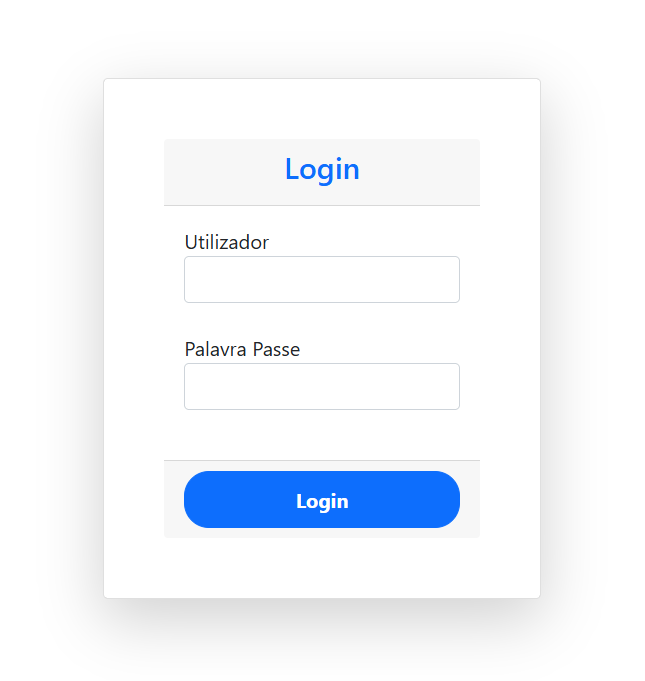
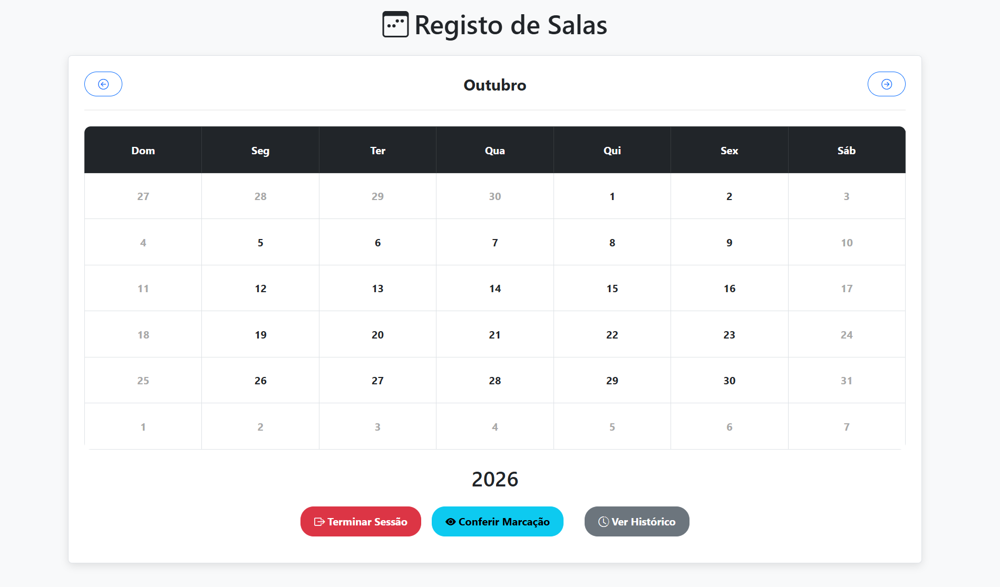
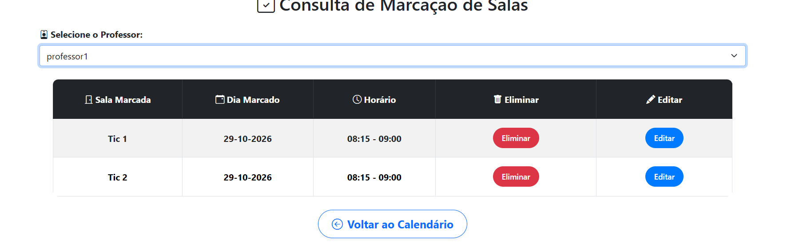
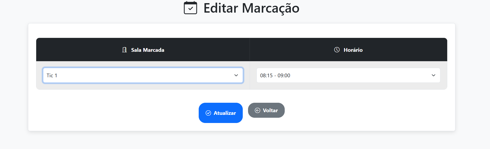
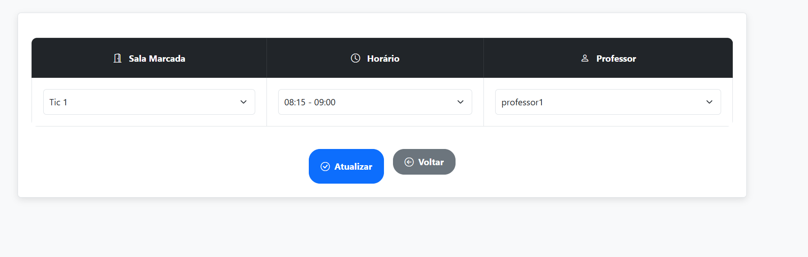

# Sistema de Gestão e Reserva de Salas

Projeto de Aptidão Profissional (PAP) desenvolvido no curso profissional de Gestão e Programação de Sistemas Informáticos.

## Sobre
Aplicação web de gestão e marcação de salas, com login, calendário, perfis de utilizador e consulta/gestão de reservas.

## Tecnologias
PHP, MySQL (PDO), JavaScript, HTML, CSS, Bootstrap e jQuery.

## Funcionalidades presentes no código
- Autenticação com `password_verify()` e sessão PHP;
- Consulta do calendário e horários;
- Criação, edição e remoção de reservas;
- Gestão de utilizadores e histórico.

## Como executar localmente
1. Instalar PHP 8.x com extensão `pdo_mysql` e MySQL 8.x (ou ambiente local equivalente).
2. Criar uma base de dados chamada `sala_livre` e importar `sala_livre.sql`.
3. Na pasta principal do projeto, criar um ficheiro chamado `config.local.php` com os dados locais da base de dados:

   ```php
   <?php
   return [
       'DB_HOST' => '127.0.0.1',
       'DB_NAME' => 'sala_livre',
       'DB_USER' => 'root',
       'DB_PASSWORD' => 'A_TUA_PASSWORD_LOCAL',
   ];
   ```

   Substituir o valor de `DB_PASSWORD` pela password local do MySQL (e os restantes valores, se forem diferentes). **Nunca publicar `config.local.php` ou passwords reais no GitHub.** Como alternativa, a aplicação suporta as variáveis de ambiente `DB_HOST`, `DB_NAME`, `DB_USER` e `DB_PASSWORD`.
4. Iniciar o servidor local na pasta do projeto, por exemplo `php -S localhost:8000`, e abrir `http://localhost:8000/_index.php`.
5. Criar um utilizador inicial no MySQL com uma password gerada por `php -r 'echo password_hash("ALTERAR_PASSWORD", PASSWORD_DEFAULT), PHP_EOL;'`; atribuir `tipo=0` para administrador. Nunca reutilizar passwords de produção.

## Preparação para GitHub
O histórico `.git` antigo e os registos originais da base de dados não fazem parte desta cópia. As credenciais da base de dados são configuradas localmente através de `config.local.php` ou variáveis de ambiente, e vários acessos SQL usam parâmetros.

## Limitações / segurança
Esta é uma **versão de portfólio académico, não auditada para produção**. Foi feita uma revisão estática e verificação de sintaxe, mas **não foram executados testes de ponta a ponta com MySQL**. Antes de disponibilizar a aplicação publicamente, rever as rotas AJAX, validar permissões por função, testar proteção CSRF e regras de agendamento, tratar erros, rever a exposição de dados e realizar testes de segurança.

## Autor
Luiz Trivilin — Projeto académico (PAP).

## Capturas de ecrã

### Autenticação


### Calendário de reservas


### Consulta de marcações


### Edição de marcações


### Gestão de marcações pelo administrador



